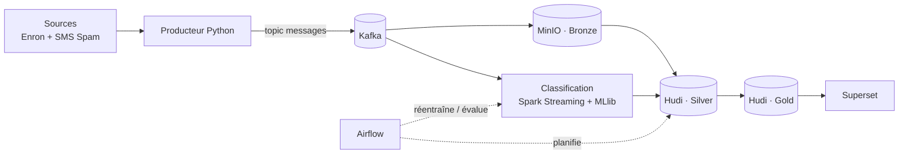

# IL-15 — Filtrage de spam à grande échelle

Projet Big Data (filière IL, groupe de 4) : chaîne de données complète, de la source au tableau de bord.
**Ce dépôt contient la structure initiale : le code reste à écrire par l'équipe.**

## Architecture



Objectif : `docker compose up` lance toute la plateforme. Détails : [docs/architecture.md](docs/architecture.md).

## Organisation du dépôt

```
├── docker-compose.yml     # squelette : sections par propriétaire
├── Makefile · .env.example
├── .github/               # CODEOWNERS, modèles d'issue / PR, CI
├── docs/                  # architecture, contrat d'interface, schéma du message, workflow Git, ADR, rapport, soutenance
├── infra/                 # init PostgreSQL, test de fumée
├── data/                  # données locales (non versionnées)
├── producer/   ← E1       # sources + Kafka
├── lakehouse/  ← E2       # MinIO + Hudi
├── spark/      ← E3       # traitements Spark + MLlib
├── airflow/    ← E4       # orchestration
├── superset/   ← E4       # dashboard
└── tests/
```

| Étudiant | Dossiers | Services Compose à ajouter |
|---|---|---|
| E1 | `producer/`, `data/` | kafka, kafka-init, kafka-ui, producer |
| E2 | `lakehouse/` | minio, minio-init |
| E3 | `spark/` | spark-master, spark-worker, spark-client, jobs de streaming |
| E4 | `airflow/`, `superset/` | airflow-*, superset |
| Tous | `docker-compose.yml`, `docs/`, `.env.example` | postgres |

Chaque dossier a son README (mission, fichiers prévus, tâches). Les fichiers de code ne contiennent qu'un en-tête.

## Règles d'équipe
- Une branche par tâche, pull request relue par un autre membre, pas de commit direct sur `main` : [docs/git_workflow.md](docs/git_workflow.md).
- Noms figés (topic, buckets, tables, DAG, ports) : [docs/contrat_interface.md](docs/contrat_interface.md). Toute modification est annoncée.
- Jamais de secret dans Git : copier `.env.example` en `.env` (`make init`).
