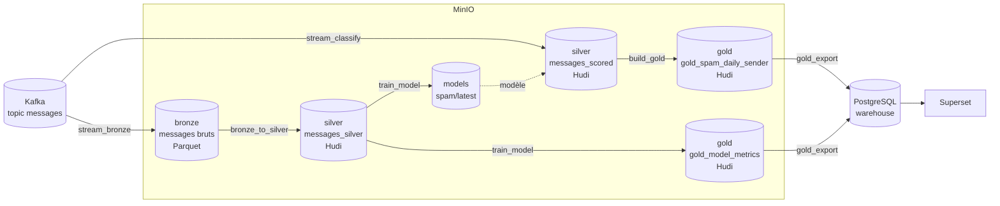

# Arborescence du Data Lake

## 1. Buckets MinIO

| Bucket | Rôle | Écrit par | Lu par |
|---|---|---|---|
| `bronze` | Messages bruts de Kafka | Job `stream_bronze` (E3) | `bronze_to_silver` (E3) |
| `silver` | Tables Hudi `messages_silver`, `messages_scored` | Jobs Spark (E3) via le writer (E2) | E3, E4 |
| `gold` | Tables Hudi `gold_spam_daily_sender`, `gold_model_metrics` | `build_gold`, `train_model` (E3) | `gold_export` (E2), dashboard (E4) |
| `models` | Modèles MLlib versionnés + alias `latest` | `train_model`, `promote_model` (E3) | `stream_classify` (E3) |
| `checkpoints` | Points de reprise du streaming | Jobs de streaming (E3) | Jobs de streaming (E3) |

## 2. Arborescence détaillée

```
s3a://bronze/
└── messages/
    └── ingest_date=2026-11-20/part-0000.parquet     # Parquet partitionné par date d'ingestion

s3a://silver/
├── messages_silver/        event_date=2026-11-20/ …  # table Hudi (clé message_id)
└── messages_scored/        event_date=2026-11-20/ …  # table Hudi (clé message_id)

s3a://gold/
├── gold_spam_daily_sender/ event_date=2026-11-20/ …  # table Hudi (clé event_date,sender)
└── gold_model_metrics/                               # table Hudi non partitionnée (clé run_id)

s3a://models/
└── spam/
    ├── 20261120103000-lr/                            # modèle versionné
    └── latest/                                       # modèle en production

s3a://checkpoints/
├── bronze_messages/
└── classify_messages/
```

## 3. Conventions

| Règle | Détail |
|---|---|
| Noms | minuscules, `_` entre les mots, pas d'accent ni d'espace |
| Partitionnement | par **date** : `ingest_date` en Bronze, `event_date` en Silver / Gold |
| Bronze | **immuable** : on ne modifie ni ne supprime jamais un fichier |
| Silver | une seule ligne par `message_id` (upsert Hudi) |
| Gold | tables petites, agrégées, prêtes pour le dashboard |
| Accès | uniquement par `s3a://…` depuis Spark ; identifiants lus dans les variables d'environnement, **jamais dans le code** |
| Changement d'un nom | annoncé à l'équipe et reporté dans `docs/contrat_interface.md` dans la même pull request |

## 4. Format de la zone Bronze (à implémenter en P1)

Parquet, avec une ligne par message Kafka reçu :

| Colonne | Type | Rôle |
|---|---|---|
| `raw_value` | string | JSON du message **tel que reçu** (non modifié) |
| `kafka_key` | string | Clé Kafka (`sender`) |
| `kafka_topic` | string | Topic d'origine |
| `kafka_partition` | int | Partition |
| `kafka_offset` | long | Position dans la partition |
| `kafka_timestamp` | timestamp | Date de réception par Kafka |
| `ingest_ts` | timestamp | Date d'écriture dans Bronze |
| `ingest_date` | date | Colonne de partition |

## 5. Schéma des zones


